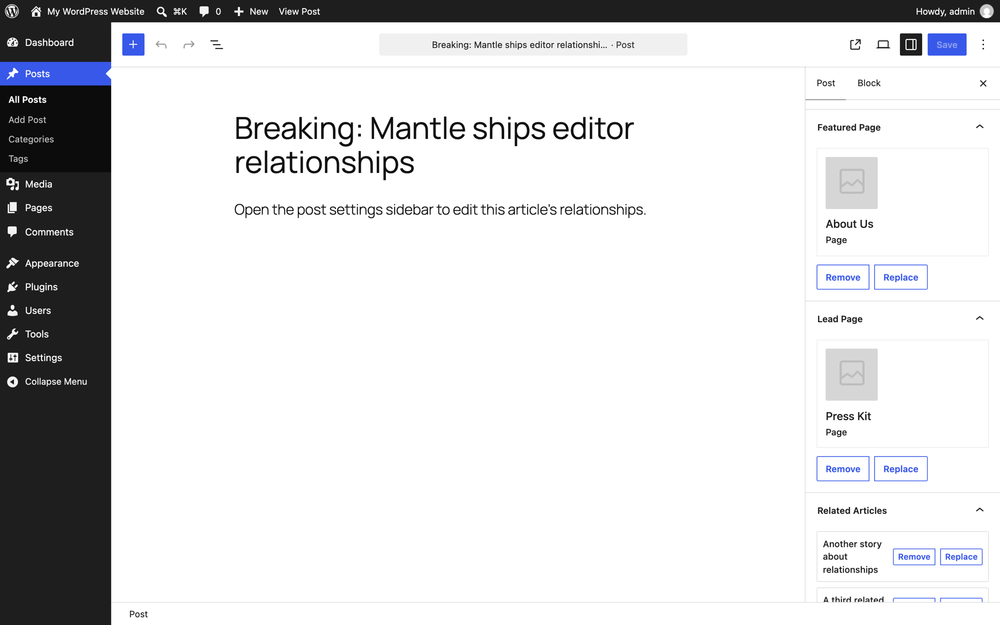
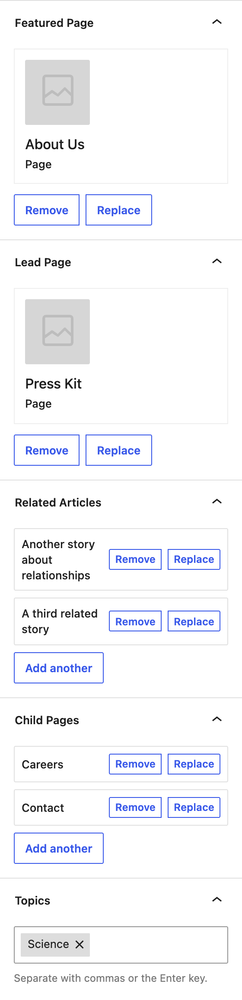

# Mantle Editor Relationships

Contributors: srtfisher

Tags: alleyinteractive, mantle, gutenberg, relationships

Stable tag: 0.0.0

Requires at least: 6.6

Tested up to: 7.1

Requires PHP: 8.4

License: GPL v2 or later

[](https://github.com/alleyinteractive/mantle-editor-relationships/actions/workflows/all-pr-tests.yml)

> [!WARNING]
> **Work in progress.** This plugin is under active development and is not ready for production use. Its PHP API, REST field, storage rules, and editor UI may change without notice.

Edit [Mantle](https://mantle.alley.com/) model relationships in the block editor.

Mantle relationships (`has_one()`, `has_many()`, `belongs_to()`, `belongs_to_many()`) are normally set in PHP. This plugin lets you opt individual relationships in to the block editor: each one gets a panel in the post's settings sidebar. Related posts are picked with the [`PostPicker`](https://github.com/alleyinteractive/alley-scripts/tree/main/packages/block-editor-tools) search modal (one per related post, each with Replace and Remove), and related terms with the `TermSelector` token field. Selections are saved with the post through Mantle's own relation APIs, so `$article->related_articles` returns exactly what the editor picked.



## Installation

```bash
composer require alleyinteractive/mantle-editor-relationships
```

Activate the plugin in WordPress. It depends on `mantle-framework/database` and does not require a full Mantle application.

## Usage

Add the `#[Editor_Relationship]` attribute to a relationship method on a post model:

```php
use Mantle\Database\Model\Post;
use Mantle\Database\Model\Relations\Belongs_To;
use Mantle\Database\Model\Relations\Belongs_To_Many;
use Mantle\Database\Model\Relations\Has_Many;
use Mantle\Editor_Relationships\Attributes\Editor_Relationship;

class Article extends Post {
	public static $object_name = 'post';

	#[Editor_Relationship( label: 'Featured Page' )]
	public function featured_page(): Belongs_To {
		return $this->belongs_to( Page::class, null, 'featured_page_id' );
	}

	#[Editor_Relationship( label: 'Related Articles', max: 3 )]
	public function related_articles(): Belongs_To_Many {
		return $this->belongs_to_many( Article::class, null, 'related_article_ids' )->uses_terms();
	}

	#[Editor_Relationship]
	public function tags(): Has_Many {
		return $this->has_many( Tag::class );
	}
}
```

The attribute accepts an optional `label` (defaults to a headline of the method name, e.g. "Related Articles") and `max`, the most items a `has_many()` or `belongs_to_many()` relationship can hold.

Then tell the plugin about the model. In a Mantle application, models from the model manifest and the `models.register` config are discovered automatically. Anywhere else, use the filter or the helper:

```php
add_filter( 'mantle_editor_relationships_models', fn ( array $models ) => [ ...$models, Article::class ] );

// Or call this before `rest_api_init`, e.g. on `init`:
Mantle\Editor_Relationships\discover_relationships( Article::class );
```

To opt in a relationship without the attribute, such as one on a model you don't own, register it directly:

```php
Mantle\Editor_Relationships\register_relationship( Article::class, 'related_articles', [ 'label' => 'Related Articles', 'max' => 3 ] );
```

### Supported relationships

The parent must be a `Mantle\Database\Model\Post`. The related model can be a post or a term model.

| Relation | Cardinality | Editor control | Where the data is stored |
| --- | --- | --- | --- |
| `belongs_to()` | Many-to-one | Single | Meta on the post being edited |
| `has_one()` | One-to-one | Single | Meta on the related post |
| `has_many()` | One-to-many | Multiple | Meta on the related posts, the internal relationship taxonomy with `->uses_terms()`, or core terms when relating to a term model |
| `belongs_to_many()->uses_terms()` | Many-to-many | Multiple | The internal relationship taxonomy on the post being edited |



A few things to know:

- `belongs_to_many()` must chain `->uses_terms()`. A meta-backed `belongs_to_many()` only reads back its first value, so the plugin refuses to register it.
- `belongs_to()` and `has_one()` must not chain `->uses_terms()`. Mantle saves a single relationship term without appending, which removes every other relationship term on the post, so the plugin refuses to register them.
- Term models can't be the parent: the panels edit posts, so relate from the post side (`has_many( Tag::class )`).
- Two `belongs_to*()` relationships to the same model need distinct local keys, otherwise they share the same meta key (`featured_page_id` and `related_article_ids` above).
- `has_one()` and `has_many()` relating to posts are stored on the related posts, so saving one requires the user to be able to edit every post being added or removed.
- The related post type or taxonomy must be registered with `show_in_rest`, since the editor searches it through the REST API.
- Related items are returned in the related model's default query order, not the order they were picked in. Related posts of any status other than trash are read and kept, but the picker only searches published content.
- Relationship changes are saved when the post is saved; autosaves and previews do not include them.

### REST API

Each post type with editable relationships gets a `mantle_relationships` field in the `edit` context, keyed by relationship method. Single relationships are an ID or `null`; multiple relationships are a list of IDs.

```json
{
  "mantle_relationships": {
    "featured_page": 12,
    "related_articles": [ 34, 56 ],
    "tags": [ 7 ]
  }
}
```

Sending the field in an update replaces the relationships it includes and leaves the others alone. Every value is validated before any relationship is written; a failure while writing returns a `500` error.

## Development

```sh
npm install
composer install
composer dev
```

`composer dev` starts a `wp-env` environment with the plugin activated and runs the front-end build in watch mode. The editor panel lives in `entries/relationships-panel/` and is built to `build/relationships-panel/`.

## Testing

Run `npm test` for TypeScript checks, ESLint, Stylelint and Jest, and `composer test` for phpcs, PHPStan, Rector and PHPUnit.

## Releasing the Plugin

The plugin uses
[action-release](https://github.com/alleyinteractive/action-release) via a
[built release workflow](./.github/workflows/built-release.yml) to compile and
tag releases. Whenever a new version is detected in the root plugin's headers in
the `mantle-editor-relationships.php` file or in the `composer.json` file, the workflow will
automatically build the plugin and tag it with a new version. The built tag will
contain all the required front-end assets the plugin may require. This works
well for publishing to WordPress.org or for submodule-ing.

When you are ready to release a new version of the plugin, you can run
`npm run release`/`composer release` to start the process of setting up a new
release. If you want to do this manually you can follow these steps:

1. Change the `Version` in the `mantle-editor-relationships.php` file to a new higher-level version.

	```diff
	- * Version: 0.0.0
	+ * Version: 0.0.1
	```

	**✨ `npm run release` will do this for you automatically.**

2. Commit your changes and push to the repository.
3. Check the actions tab in the repository to see the progress of the release.
   The action will automatically create a new tag and release for the plugin.
   You are done!

## Changelog

Please see [CHANGELOG](CHANGELOG.md) for more information on what has changed recently.

## Credits

This project is actively maintained by [Alley
Interactive](https://github.com/alleyinteractive). Like what you see? [Come work
with us](https://alley.com/careers/).

- [Sean Fisher](https://github.com/srtfisher)
- [All Contributors](../../contributors)

## License

The GNU General Public License (GPL) license. Please see [License File](LICENSE) for more information.